# Demonstração da VagaLoop

Telas do sistema rodando em modo demonstração (`npm run demo`), com dados fictícios e IA em modo básico (sem chave).

Logins: `empresa@vagaloop.dev`, `candidata@vagaloop.dev`, `admin@vagaloop.dev`, `recrutadora@vagaloop.dev`, senha `demo12345`.

## Página inicial

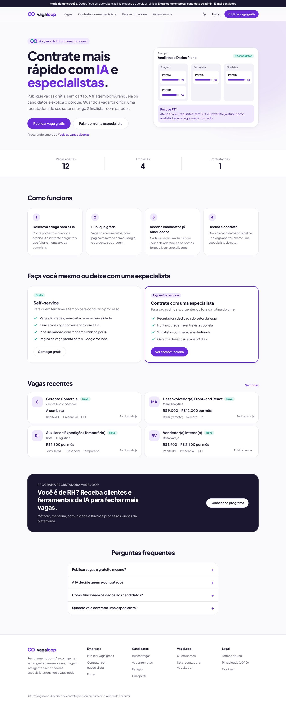

## Vagas com filtros

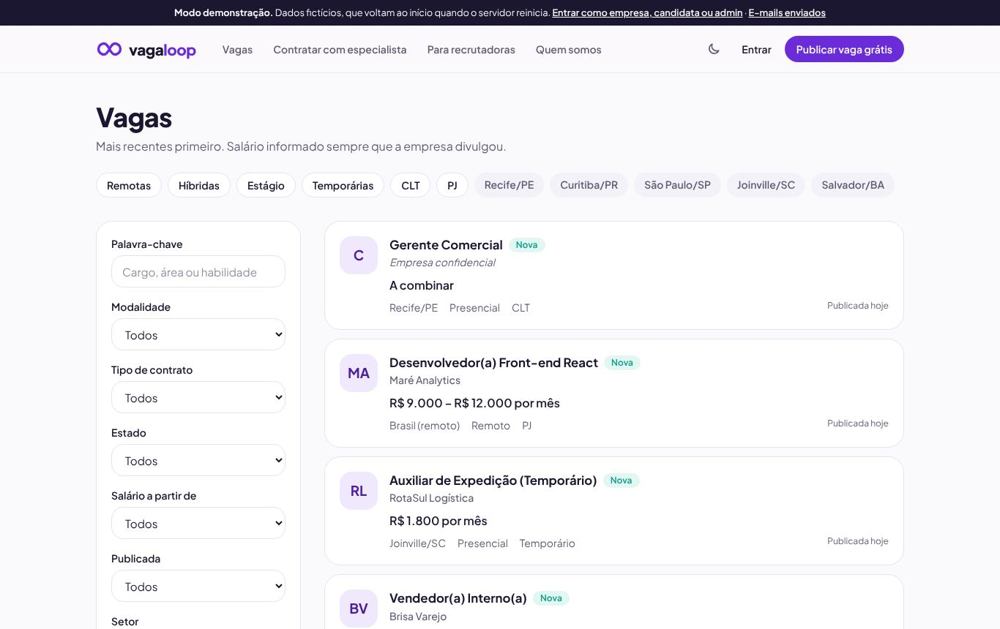

## Página da vaga

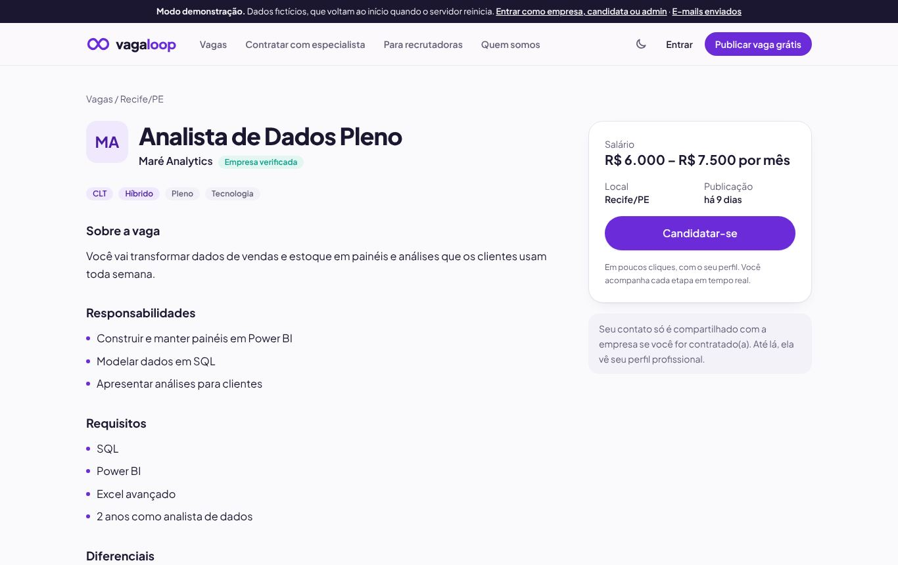

## Contratar com especialista

## Programa de recrutadoras

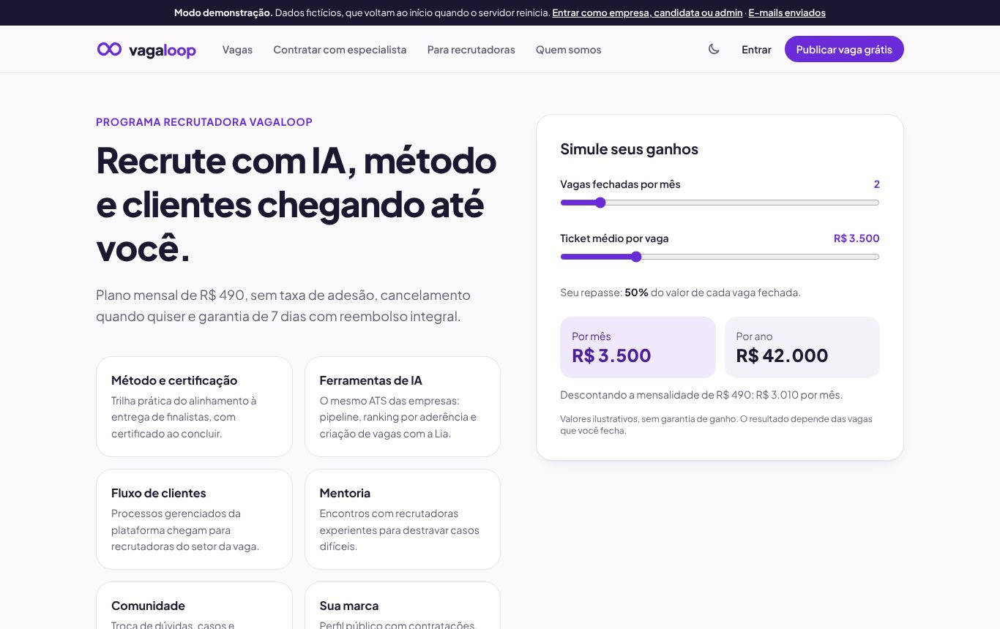

## Empresa: visão geral

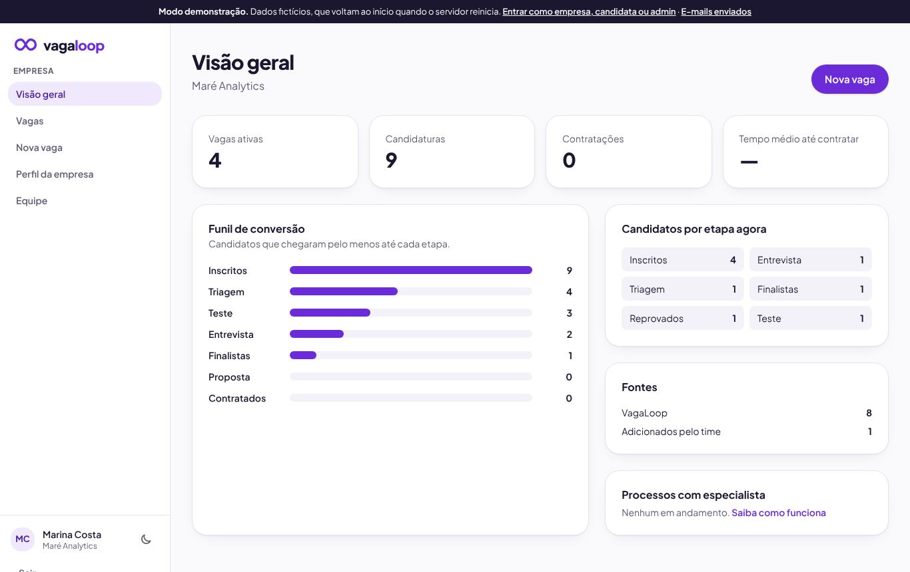

## Empresa: pipeline

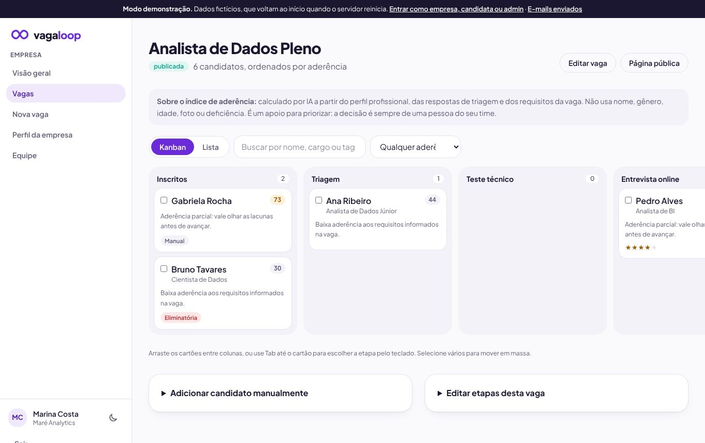

## Empresa: detalhe da candidatura

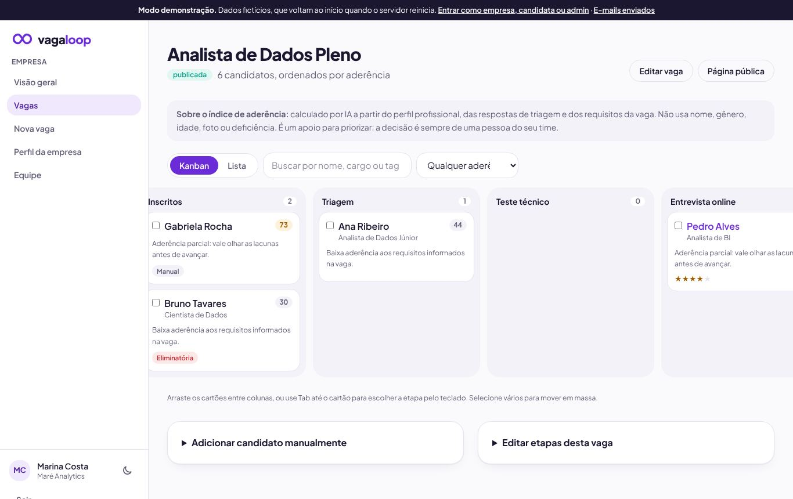

## Empresa: criar vaga com a Lia

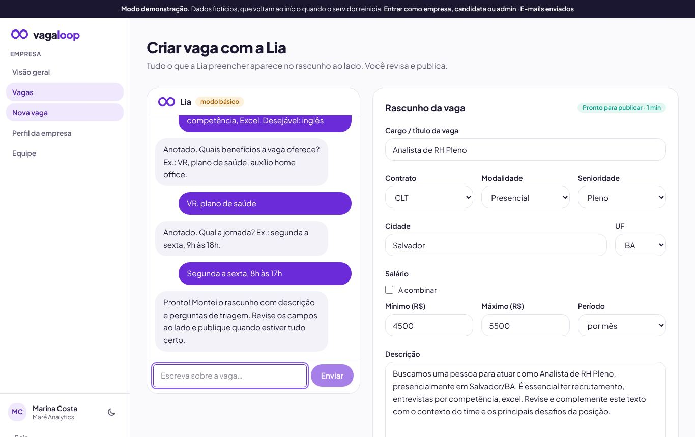

## Candidata: minhas candidaturas

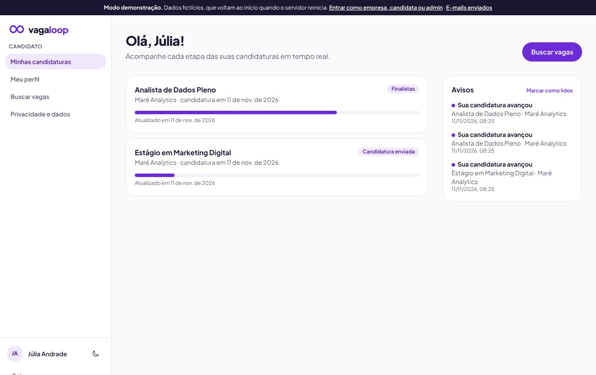

## Candidata: perfil e currículo

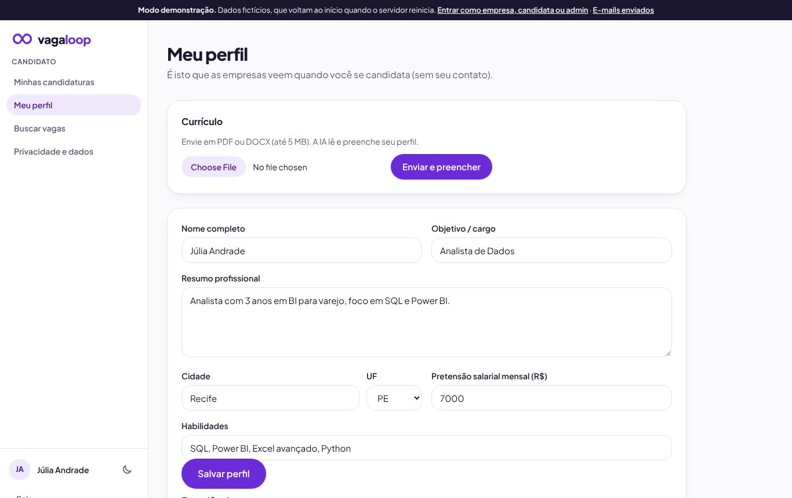

## Admin: métricas

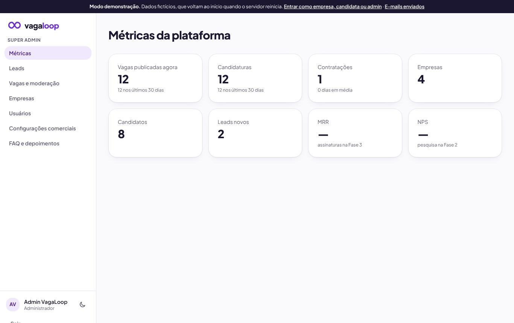

## Admin: configurações comerciais

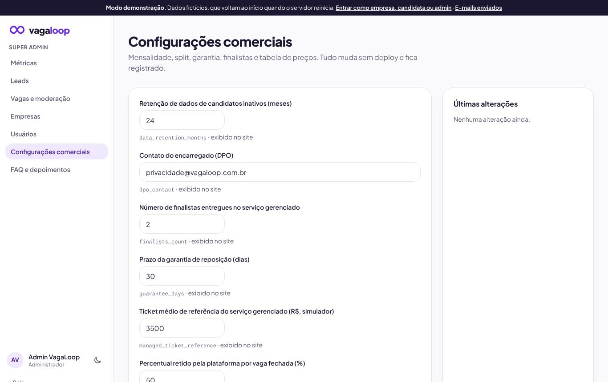

## Admin: moderação

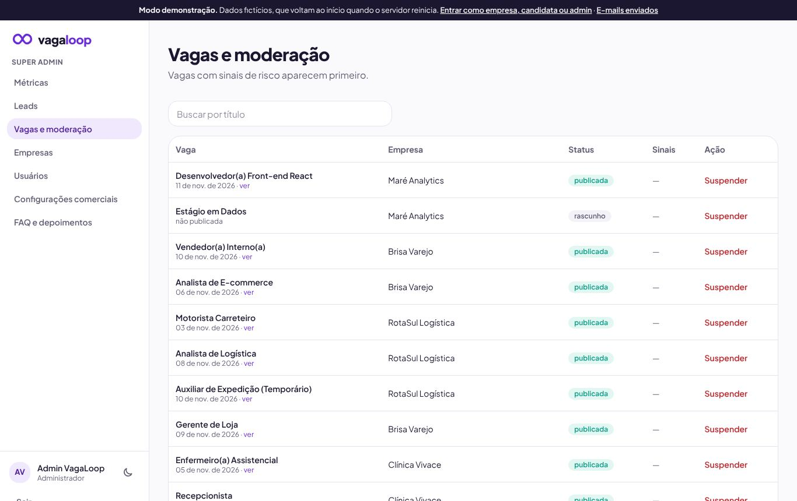

## Celular, tema escuro

## E-mails da demonstração

